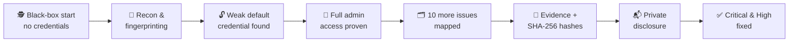

# First-public-website-hack
My first successful public website penetration test. Full admin access, real impact, responsible disclosure.

<div align="center">


<br><br>

**The most dangerous vulnerability isn't always a zero-day.**
**Sometimes it's a password nobody ever changed.** 🔓

</div>

---

## 📖 The Story

In **September 2026** I carried out a short, **authorized black-box penetration test** against the production web portal of an educational institution. No credentials, no inside knowledge, just a browser, a few tools and a checklist.

After fingerprinting the technology stack, I ran a small, pre-agreed check for factory-default credentials.

> 🎯 **Result:** a privileged account was still using its factory-default password.

That single oversight exposed the entire management backend: student applications, academic records, selection dashboards and internal reports. All of it was **personal information about minors**.

---

## 📸 Visual Evidence

> 🔒 *Sensitive details such as names, IDs and internal addresses are redacted. Images are shown small; click any to enlarge.*

### 🖥️ Behind the Admin Panel

<table>
  <tr>
    <td align="center">
      <a href="P%20Screenshots/admin1.png"></a>
      <br><sub><b>📊 Dashboard Overview</b></sub>
    </td>
    <td align="center">
      <a href="P%20Screenshots/admin2.png"></a>
      <br><sub><b>📈 Stream &amp; Selection Metrics</b></sub>
    </td>
  </tr>
  <tr>
    <td align="center">
      <a href="P%20Screenshots/admin3.png"></a>
      <br><sub><b>📋 Application Listing</b></sub>
    </td>
    <td align="center">
      <a href="P%20Screenshots/admin4.png"></a>
      <br><sub><b>🎓 Official Student Report</b></sub>
    </td>
  </tr>
</table>

### 🔬 Technical Evidence

<table>
  <tr>
    <td align="center">
      <a href="P%20Screenshots/report1.png"></a>
      <br><sub><b>🏗️ Internal Infrastructure Leak</b></sub>
    </td>
    <td align="center">
      <a href="P%20Screenshots/report2.png"></a>
      <br><sub><b>↪️ Open Redirect Proof</b></sub>
    </td>
  </tr>
  <tr>
    <td align="center">
      <a href="P%20Screenshots/report3.png"></a>
      <br><sub><b>🧩 Module Enumeration</b></sub>
    </td>
    <td align="center">
      <a href="P%20Screenshots/report4.png"></a>
      <br><sub><b>🔐 Evidence Integrity (SHA-256)</b></sub>
    </td>
  </tr>
</table>

---

## 🚨 Findings Scorecard

| ID | Finding | Severity | CVSS |
|:-:|:--|:-:|:-:|
| F-00 | Default administrative credentials in production | 🔴 Critical | 9.8 |
| F-01 | Internal infrastructure disclosure via unauthenticated API error | 🟠 High | 7.5 |
| F-02 | Open redirect | 🟡 Medium | 4.3 |
| F-03 | Verbose stack traces in error responses | 🟡 Medium | 5.3 |
| F-04 | Missing CSRF token on public contact form | 🟡 Medium | 4.3 |
| F-05 | User enumeration via password reset | 🟡 Medium | 5.3 |
| F-10 | Installed module list exposed without authentication | 🟡 Medium | 5.3 |
| F-06 | Version disclosure via public API | 🔵 Low | 5.3 |
| F-07 | Cookies missing `Secure` / `SameSite` | 🔵 Low | 3.7 |
| F-08 | Missing Content-Security-Policy | 🔵 Low | 3.1 |
| F-09 | Incomplete HSTS coverage | 🔵 Low | 3.1 |

```
Critical  █                        1
High      █                        1
Medium    █████                    5
Low       ████                     4
          ─────────────────────────
          Total                   11
```

---

## 🗺️ The Journey



| Phase | What happened |
|:-:|:--|
| 1️⃣ | **Reconnaissance**: identified the technology stack |
| 2️⃣ | **Automated scanning**: baseline coverage with standard tools |
| 3️⃣ | **Manual testing**: default-credential check, error handling, session and endpoint review |
| 4️⃣ | **Proof of concept**: confirmed impact with minimal, non-destructive actions |
| 5️⃣ | **Reporting**: severity ratings, remediation roadmap and hashed evidence |
| 6️⃣ | **Responsible disclosure**: reported privately to the organization |

---

## ✅ What They Did Right

It wasn't all bad. The team had real controls in place:

- 🛡️ Database not accessible without authentication
- 🔑 Student data endpoints enforce login
- 📧 OTP email verification on student registration
- ☁️ WAF blocking common automated attacks
- 🍪 `HttpOnly` session cookies
- 🧱 `X-Frame-Options` and `X-Content-Type-Options` set correctly
- 💉 Protection against SQL injection

> *Good defenses almost everywhere, and one unchanged password undid the lot.*

---

## 🤝 The Response

The organization responded quickly and professionally. **All critical and high severity issues were fixed.** 🛡️

> *This is what responsible disclosure should look like.*

---

## 💡 Lessons Learned

<div align="center">

> ### 🔑 Change default credentials on day one.
> *They remain one of the simplest and most devastating attack vectors.*

</div>

- 🚪 **Check the doors everyone assumes are locked.**
- 🔒 **Default credentials must never reach production.** Change them, then add MFA.
- 🧱 **Defense in depth matters.** One strong layer can't carry the whole system.
- 🧾 **Error messages should be boring.** Stack traces and version banners are free recon for attackers.
- 🎓 **Student data deserves extra care.** Records of minors carry legal and ethical weight.
- 📬 **Report privately, report responsibly.**

---

## ⚖️ Disclaimer

| ✅ | Statement |
|:-:|:--|
| ✔️ | This was a **fully authorized** engagement |
| ✔️ | **No data was modified or deleted** |
| ✔️ | Critical and high severity issues have been **remediated** |
| ✔️ | The organization is **intentionally not named**, and sensitive details are redacted |
| ✔️ | Shared for **educational and awareness** purposes only |

---

<div align="center">

### 👤 Security Researcher

**Yasas Dulanjan**
*September 2026*

<br>

*"The best lock in the world is useless if nobody changes the factory key."* 🔐

</div>
